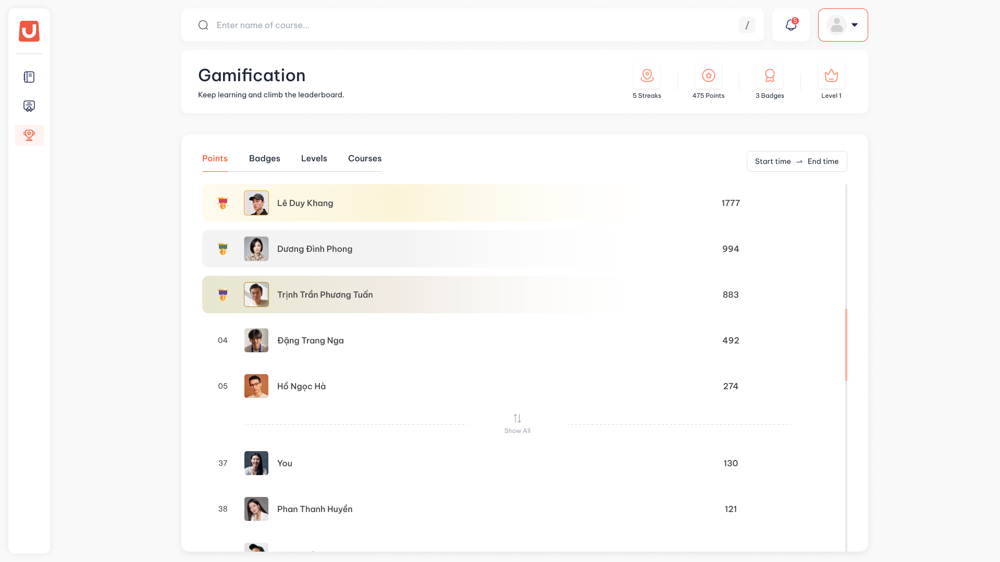

# Gamification

## I. Thông tin chung


**Dành cho:** Học viên

**Đường dẫn:** LMS → Gamification



#### Phạm vi & Module liên quan

* **Module chính:** Gamification
* **Module liên quan:** My Learning, My Profile (tab Badges), Course



#### Điều kiện tiên quyết

* Học viên đăng nhập thành công vào hệ thống.
* Tổ chức đã bật Gamification cho học viên. Nếu menu không có mục **Gamification**, tổ chức chưa mở tính năng này.


Gamification ghi nhận việc học của bạn thành điểm, huy hiệu và hạng ngay khi bạn học. Bạn không cần bấm gì thêm: vào hệ thống mỗi ngày, hoàn thành hoạt động, hoàn thành khoá và qua bài Test là được ghi nhận.

### Nội dung trong mục này

* [**Cách nhận điểm**](cach-nhan-diem.md): Hành động nào được điểm, chuỗi ngày vào học, thông báo thành tích và lịch sử ghi nhận.
* [**Huy hiệu và hạng**](huy-hieu-va-hang.md): Bốn loại huy hiệu cùng mốc của từng loại, cách lên hạng.
* [**Bảng xếp hạng và campaign**](bang-xep-hang.md): Xem thứ hạng của mình theo từng khung thời gian và trong các đợt thi đua.

## II. Hướng dẫn chi tiết



**Mở màn Gamification**

Chọn **Gamification** tại menu sidebar.

<figure><figcaption></figcaption></figure>

Màn gồm ba phần từ trên xuống:

* Dải tóm tắt bốn ô: chuỗi ngày, điểm, huy hiệu và hạng của bạn.
* Bảng xếp hạng.
* Vị trí của bạn trên bảng xếp hạng.



**Xem dải tóm tắt**

| Ô | Ý nghĩa | Bấm vào |
| --- | --- | --- |
| **Streaks** | Số ngày liên tiếp bạn có vào hệ thống. Bỏ trọn một ngày thì về `0` | Không có thao tác, chỉ để xem |
| **Points** | Tổng điểm tích luỹ từ trước tới nay | Mở panel **How to collect points?**, xem mỗi hành động được bao nhiêu điểm |
| **Badges** | Số huy hiệu đã đạt | Chuyển sang **My Profile → Badges**, xem toàn bộ huy hiệu |
| **Level** | Hạng hiện tại và số điểm đã tích trong hạng, ví dụ `700 / 750 pts` | Mở panel **How to level up?**, xem cần bao nhiêu điểm để lên hạng kế tiếp |

Học viên mới chưa có điểm vẫn vào được màn này: các ô hiện `0`, hạng là `Level 1`.



**Xem nhanh điểm và hạng ở My Learning**

Đầu màn **My Learning** có một dòng nhỏ hiện điểm và hạng của bạn. Bấm vào dòng này để mở màn Gamification.



## III. Lưu ý & Quy tắc nghiệp vụ


### Mẹo sử dụng

1. Mỗi chức năng (điểm, huy hiệu, hạng, bảng xếp hạng) do tổ chức bật riêng. Chức năng nào đang tắt thì ô hoặc phần tương ứng không hiện. Dữ liệu của bạn vẫn được giữ, tổ chức bật lại thì hiện lại đầy đủ.
2. Điểm, huy hiệu và hạng đã nhận **không bị lấy lại**. Hạng chỉ lên, không tụt. Tổ chức đổi cấu hình thì chỉ áp dụng cho các lần ghi nhận sau đó.
3. Màn này chỉ để xem. Bạn không sửa được điểm, hạng hay huy hiệu.


## IV. Các lỗi thường gặp & Hướng dẫn xử lý

| Lỗi / Tình huống | Nguyên nhân | Cách xử lý |
| --- | --- | --- |
| Không thấy mục **Gamification** trên menu | Tổ chức chưa bật Gamification cho học viên, hoặc tài khoản là tài khoản kiểm thử | Liên hệ đội vận hành nếu cho rằng đây là sai sót |
| Không thấy ô **Points**, **Badges** hoặc **Level** | Tổ chức đang tắt chức năng tương ứng | Dữ liệu vẫn được giữ. Ô hiện lại khi tổ chức bật lại |
| Vừa học xong mà điểm trên bảng xếp hạng chưa đổi | Bảng xếp hạng tính lại khoảng 8 tiếng một lần. Ô **Points** ở dải tóm tắt cập nhật ngay | Xem thời điểm cập nhật ở nhãn **Last updated** trên bảng xếp hạng |
