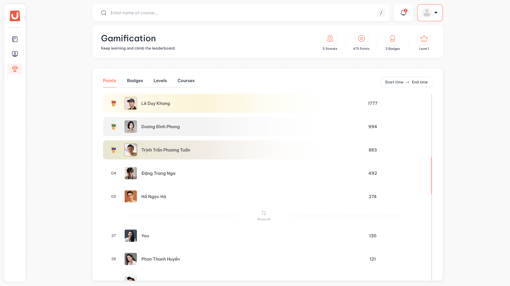

---
layout:
  width: default
  title:
    visible: true
  description:
    visible: false
  tableOfContents:
    visible: true
  outline:
    visible: true
  pagination:
    visible: true
  metadata:
    visible: false
  tags:
    visible: true
  actions:
    visible: true
---

# Bảng xếp hạng và campaign

## I. Thông tin chung


**Dành cho:** Học viên

**Đường dẫn:** LMS → Gamification → phần bảng xếp hạng



#### Phạm vi & Module liên quan

* **Module chính:** Gamification (Leaderboard, Campaign)
* Bảng xếp hạng tính trên toàn tổ chức, công khai tên và ảnh đại diện của học viên.



#### Điều kiện tiên quyết

* Học viên đăng nhập thành công vào hệ thống.
* Tổ chức đã bật Gamification và chức năng bảng xếp hạng.


## II. Hướng dẫn chi tiết

Bảng xếp hạng



**Mở bảng xếp hạng**

Bảng xếp hạng nằm trên màn Gamification, ngay dưới dải tóm tắt.

<figure><figcaption></figcaption></figure>



**Chọn bảng**

Mỗi chỉ số là một bảng riêng. Chọn tab để chuyển bảng:

| Tab | Xếp theo |
| --- | --- |
| **Points** | Điểm (bảng mặc định) |
| **Activities** | Số hoạt động học đã hoàn thành |
| **Courses** | Số khoá đã hoàn thành |
| **Badges** | Số huy hiệu đã đạt |
| **Level** | Hạng, cùng hạng thì xếp theo điểm trong hạng |

Tổ chức quyết định bảng nào được hiện, nên bạn có thể thấy ít hơn năm tab.



**Chọn khung thời gian**

Chọn một trong năm khung: **All time** (mặc định) · **This week** · **This month** · **This quarter** · **This year**. Khoảng ngày của khung đang chọn hiện ngay bên cạnh.

* Tuần bắt đầu từ thứ Hai. Tháng, quý, năm tính theo lịch.
* Bảng **Badges** và **Level** chỉ có ở **All time**. Chọn khung khác thì hai tab này ẩn đi.



**Đọc bảng**

* Ba người dẫn đầu được làm nổi bật, tiếp theo là các vị trí 4 và 5.
* Bấm **Show All** để xem toàn bộ học viên. Người chưa có chỉ số nào trong khung nằm cuối danh sách, ô thứ hạng để trống.
* Dưới đường **Show All** luôn có dòng của bạn kèm một người ngay dưới, cùng một dòng cho biết bạn còn kém người ngay trên bao nhiêu. Nếu bạn nằm trong 5 người đầu, dòng của bạn được làm nổi bật ngay trong danh sách.
* Nhãn **Last updated** cho biết bảng được tính tới lúc nào. Bảng tính lại khoảng 8 tiếng một lần.



Campaign

Campaign là đợt thi đua có thời hạn do tổ chức mở, ví dụ "Thi đua học tập tháng 11". Mỗi campaign chỉ tính điểm cho một số loại hành động tổ chức chọn, và có kết quả chốt cố định khi kết thúc để trao thưởng.



**Chọn campaign**

Trên bảng xếp hạng, mở lối vào campaign nằm cạnh các khung thời gian, rồi chọn một campaign. Danh sách gồm campaign đang chạy (**In Progress**) và đã kết thúc (**Expired**).



**Xem bảng của campaign**

Campaign hiện tên, khoảng thời gian và các loại hành động được tính điểm. Mỗi campaign có tối đa ba bảng:

* **Points**: chỉ cộng điểm từ các loại hành động campaign chọn, trong khoảng thời gian của campaign.
* **Activities**: số hoạt động hoàn thành trong campaign, nếu campaign có bảng này.
* **Courses**: số khoá hoàn thành trong campaign.

Dòng của bạn và người liền kề hiện giống bảng xếp hạng chung.



**Xem kết quả chính thức**

* Campaign đang chạy: bảng là số tạm tính, cập nhật khoảng 8 tiếng một lần.
* Campaign đã kết thúc: bảng là kết quả chính thức, chốt đúng lúc kết thúc và không thay đổi nữa.



## III. Lưu ý & Quy tắc nghiệp vụ


### Lưu ý quan trọng

1. Cùng chỉ số thì ai đạt mức đó sớm hơn xếp trên. Không có hai người cùng thứ hạng.
2. Bảng theo khung thời gian là số liệu sống: bài Test chấm muộn có thể làm thứ hạng của một khung đã qua thay đổi. Kết quả chốt cố định chỉ có ở campaign đã kết thúc.
3. Bài Test nộp trong campaign nhưng được chấm đạt sau khi campaign kết thúc thì không tính cho campaign đó.
4. Không có bộ chọn khoảng ngày tự do. Muốn xem một đợt thi đua cụ thể, chọn campaign.


## IV. Các lỗi thường gặp & Hướng dẫn xử lý

| Lỗi / Tình huống | Nguyên nhân | Cách xử lý |
| --- | --- | --- |
| Vừa học xong mà thứ hạng chưa đổi | Bảng tính lại khoảng 8 tiếng một lần | Xem nhãn **Last updated**. Điểm ở dải tóm tắt vẫn cập nhật ngay |
| Không thấy tab **Badges** hoặc **Level** | Đang chọn khung khác **All time**, hoặc tổ chức đang tắt bảng đó | Chọn **All time** |
| Không có số thứ hạng ở dòng của tôi | Bạn chưa có chỉ số nào trong khung hoặc campaign đang chọn | Học và hoàn thành hoạt động để có tên trên bảng |
| Điểm trong campaign thấp hơn điểm cùng kỳ ở bảng chung | Campaign chỉ cộng điểm từ các loại hành động được chọn | Xem danh sách hành động được tính ở phần thông tin campaign |
| Không thấy campaign sắp diễn ra | Campaign chưa bắt đầu không hiện cho học viên | Campaign xuất hiện từ ngày bắt đầu |
