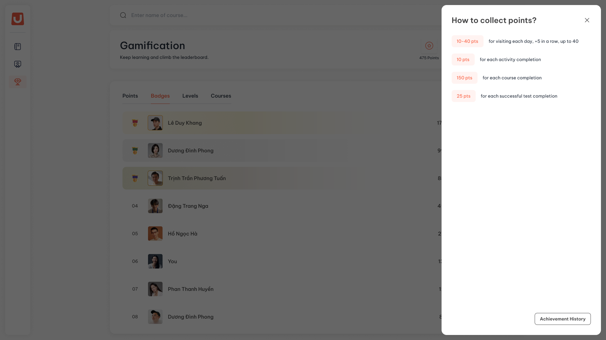
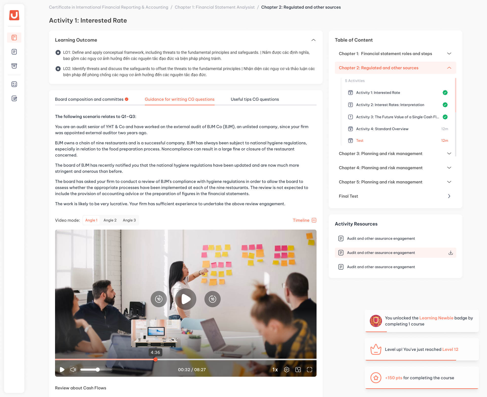
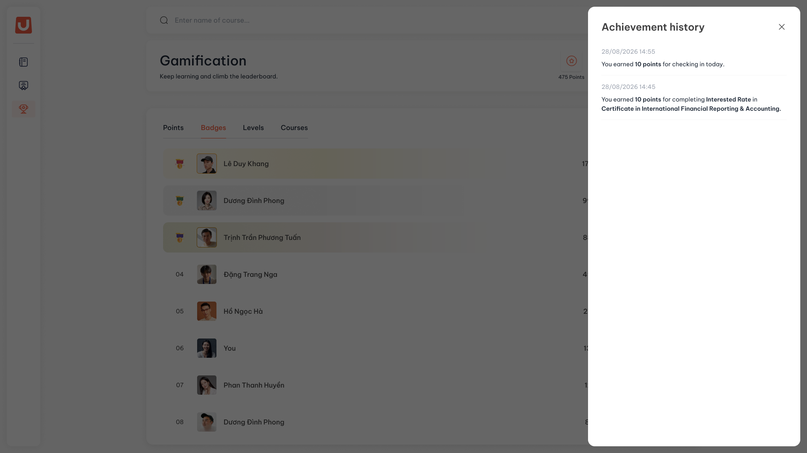

---
layout:
  width: default
  title:
    visible: true
  description:
    visible: false
  tableOfContents:
    visible: true
  outline:
    visible: true
  pagination:
    visible: true
  metadata:
    visible: false
  tags:
    visible: true
  actions:
    visible: true
---

# Cách nhận điểm

## I. Thông tin chung


**Dành cho:** Học viên

**Đường dẫn:** LMS → Gamification → ô **Points**



#### Phạm vi & Module liên quan

* **Module chính:** Gamification (Points)
* **Module liên quan:** Course, Hoạt động học, Hoạt động kiểm tra



#### Điều kiện tiên quyết

* Học viên đăng nhập thành công vào hệ thống.
* Tổ chức đã bật Gamification và chức năng điểm.


## II. Hướng dẫn chi tiết



**Xem bảng tính điểm**

Trên màn Gamification, bấm ô **Points**. Panel **How to collect points?** mở ra từ cạnh phải, mỗi dòng là một hành động kèm số điểm tổ chức đang áp dụng.

<figure><figcaption></figcaption></figure>

| Hành động | Khi nào được điểm |
| --- | --- |
| Vào hệ thống mỗi ngày | Lần đầu tiên bạn mở UpLMS trong ngày. Điểm tăng theo chuỗi ngày liên tiếp, xem bước kế tiếp |
| Hoàn thành hoạt động học | Khi hoạt động chuyển sang trạng thái hoàn thành. Hoạt động có video phải xem đủ 80% thời lượng. Hoạt động chỉ có chữ hoặc ảnh hoàn thành ngay khi mở |
| Hoàn thành khoá | Khi bạn hoàn thành toàn bộ khoá học |
| Qua bài Test | Khi bài Test đạt điểm qua (**Pass Point**). Bài Test chấm tay được cộng điểm vào lúc người chấm chấm đạt |
| Đạt huy hiệu | Mỗi lần bạn mở khoá một huy hiệu mới |

Hành động nào tổ chức đang tắt thì không có dòng đó trong panel.



**Giữ chuỗi ngày vào học**

Bạn không cần bấm nút check-in. Hệ thống tự ghi nhận khi bạn mở UpLMS lần đầu trong ngày, kể cả khi bạn vẫn đang đăng nhập từ hôm trước.

* Ngày đầu tiên của chuỗi nhận mức điểm nền. Mỗi ngày liên tiếp sau đó được thêm `5` điểm, tối đa `40` điểm một ngày. Ví dụ với điểm nền `10`: `10 · 15 · 20 · 25 · 30 · 35 · 40`, từ ngày thứ 7 trở đi mỗi ngày đều được `40`.
* Vào nhiều lần trong cùng một ngày chỉ tính một lần.
* Bỏ trọn một ngày không vào thì chuỗi về `0`. Lần vào kế tiếp bắt đầu chuỗi mới từ mức điểm nền. Điểm đã nhận trong chuỗi cũ vẫn giữ nguyên.
* Ngày tính theo giờ Việt Nam (UTC+7). Thứ Bảy, Chủ Nhật và ngày nghỉ cũng tính, nên nghỉ trọn những ngày này sẽ làm đứt chuỗi.



**Nhận thông báo thành tích**

Khi bạn nhận điểm, đạt huy hiệu hoặc lên hạng trong lúc đang mở UpLMS, một thẻ thông báo hiện ở góc dưới bên phải màn hình rồi tự tắt.

<figure><figcaption></figcaption></figure>

* Mỗi thành tích là một thẻ riêng, xếp chồng theo thứ tự xảy ra. Ví dụ qua bài Test cuối khoá có thể sinh ra bốn thẻ: điểm bài Test, điểm hoàn thành khoá, huy hiệu mới và lên hạng.
* Điểm thưởng của huy hiệu nằm chung trong thẻ huy hiệu, ví dụ `You unlocked the Check-in Grower badge by visiting 8 days · +50 pts`.
* Lên nhiều hạng cùng lúc thì chỉ có một thẻ cho hạng cao nhất vừa đạt.
* Thông báo không gửi qua email. Nếu bạn không mở UpLMS lúc thành tích phát sinh (ví dụ bài Test chấm tay được chấm sau vài ngày), bạn sẽ không nhận thẻ, nhưng thành tích vẫn được ghi và tra được trong lịch sử.



**Tra lịch sử ghi nhận**

Trong panel **How to collect points?**, bấm **Achievement History** ở cuối panel.

<figure><figcaption></figcaption></figure>

* Mỗi dòng gồm thời điểm và một câu nêu rõ bạn nhận được gì, từ hoạt động, khoá hay bài Test nào.
* Lịch sử gồm ba loại sự kiện: nhận điểm, đạt huy hiệu và lên hạng. Mới nhất ở trên cùng, cuộn xuống để xem các lần trước.
* Lịch sử giữ toàn bộ từ ngày đầu, không ai sửa hay xoá được.



## III. Lưu ý & Quy tắc nghiệp vụ


### Lưu ý quan trọng

1. Mỗi hoạt động, khoá hoặc bài Test chỉ được điểm **một lần trong một lượt học**. Mở lại hoạt động đã hoàn thành không được cộng thêm.
2. Nội dung đã hoàn thành trước ngày tổ chức bật Gamification không được tính điểm.
3. Bài Test chấm lại sau lần chấm đầu không được cộng thêm điểm. Kết quả tính theo lần chấm đầu tiên.
4. Quiz là hoạt động học, không phải bài Test: làm xong Quiz được điểm hoàn thành hoạt động, không được điểm bài Test.
5. Được thêm lại vào lớp và học lại khoá từ đầu thì lượt học mới được tính điểm lại. Chứng chỉ thì không cấp thêm.


## IV. Các lỗi thường gặp & Hướng dẫn xử lý

| Lỗi / Tình huống | Nguyên nhân | Cách xử lý |
| --- | --- | --- |
| Hôm nay đã vào học mà không có điểm check-in | Hôm nay đã được ghi nhận ở lần vào trước, hoặc tổ chức đang tắt điểm check-in | Kiểm tra trong **Achievement History**. Mỗi ngày chỉ ghi nhận một lần |
| Chuỗi ngày về `0` | Có một ngày trọn không vào hệ thống, kể cả cuối tuần | Điểm đã nhận không mất. Chuỗi mới bắt đầu từ lần vào kế tiếp |
| Hoàn thành hoạt động video mà không có điểm | Chưa xem đủ 80% thời lượng nên hoạt động chưa hoàn thành | Xem tiếp video cho đủ thời lượng |
| Làm bài Test xong mà chưa có điểm | Bài chưa đạt **Pass Point**, hoặc bài chấm tay chưa được chấm | Chờ kết quả chấm. Điểm được cộng khi bài được chấm đạt |
| Không thấy thông báo thành tích | Lúc thành tích phát sinh bạn không mở UpLMS | Tra lại trong **Achievement History** |
| Số điểm khác với số đang hiện trong panel | Tổ chức đã đổi số điểm sau lần bạn nhận | Điểm đã ghi giữ nguyên. Số mới chỉ áp cho các lần sau |
