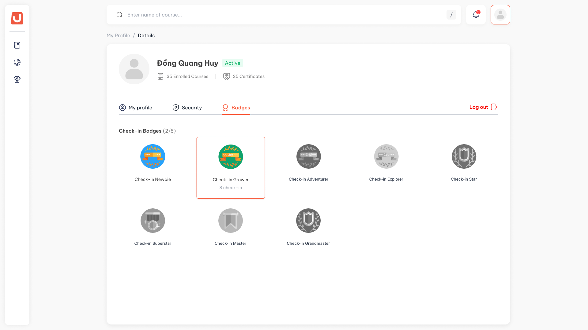

---
layout:
  width: default
  title:
    visible: true
  description:
    visible: false
  tableOfContents:
    visible: true
  outline:
    visible: true
  pagination:
    visible: true
  metadata:
    visible: false
  tags:
    visible: true
  actions:
    visible: true
---

# Huy hiệu và hạng

## I. Thông tin chung


**Dành cho:** Học viên

**Đường dẫn:**

* Huy hiệu: LMS → Gamification → ô **Badges**, hoặc **My Profile → Badges**
* Hạng: LMS → Gamification → ô **Level**



#### Phạm vi & Module liên quan

* **Module chính:** Gamification (Badges, Levels)
* **Module liên quan:** My Profile



#### Điều kiện tiên quyết

* Học viên đăng nhập thành công vào hệ thống.
* Tổ chức đã bật Gamification cùng chức năng huy hiệu hoặc hạng.


## II. Hướng dẫn chi tiết

Huy hiệu



**Mở bộ huy hiệu**

Trên màn Gamification, bấm ô **Badges**. Hệ thống chuyển sang **My Profile**, tab **Badges**.

<figure><figcaption></figcaption></figure>

* Huy hiệu xếp theo loại. Tiêu đề mỗi loại kèm bộ đếm, ví dụ `Check-in Badges (2/8)` nghĩa là đã đạt 2 trên 8 huy hiệu của loại này.
* Huy hiệu đã đạt hiện màu, chưa đạt hiện xám.



**Xem mốc của từng huy hiệu**

Trỏ chuột vào một huy hiệu để xem mốc cần đạt, ví dụ `8 check-in days`. So mốc đó với số liệu của bạn để biết còn bao xa.

Mỗi loại có tám mốc cố định:

| Loại | Đếm gì | Các mốc |
| --- | --- | --- |
| **Check-in Badges** | Tổng số ngày có vào hệ thống | 4 · 8 · 16 · 32 · 64 · 128 · 256 · 512 ngày |
| **Activity Badges** | Số hoạt động học đã hoàn thành | 10 · 25 · 50 · 100 · 200 · 400 · 800 · 1600 hoạt động |
| **Test Badges** | Số bài Test đã đạt | 2 · 4 · 8 · 16 · 32 · 64 · 128 · 256 bài |
| **Course Badges** | Số khoá đã hoàn thành | 1 · 2 · 4 · 8 · 16 · 32 · 64 · 128 khoá |

Ngày đạt từng huy hiệu không hiện ở đây. Bạn tra trong **Achievement History**, xem [Cách nhận điểm](cach-nhan-diem.md).



Hạng



**Xem hạng hiện tại**

Ô **Level** trên màn Gamification hiện hạng của bạn và số điểm đã tích trong hạng, ví dụ `Level 3` và `700 / 750 pts`.

Mọi học viên bắt đầu ở `Level 1`. Hạng là một con số, không có tên hay hình riêng.



**Xem cách lên hạng**

Bấm ô **Level**. Panel **How to level up?** cho biết hạng kế tiếp cần bao nhiêu điểm, kèm thanh tiến độ.

Cách lên hạng:

* Mọi điểm bạn nhận được (vào học mỗi ngày, hoàn thành hoạt động, hoàn thành khoá, qua bài Test, đạt huy hiệu) đều được cộng vào điểm trong hạng.
* Điểm trong hạng đủ mức yêu cầu thì bạn lên hạng ngay. Phần điểm dư được chuyển sang hạng mới. Ví dụ bạn ở hạng 3 với `700 / 750 pts`, nhận thêm `150` điểm: bạn lên hạng 4 và có sẵn `100` điểm trong hạng mới.
* Hạng càng cao càng cần nhiều điểm hơn, tới một mức tối đa do tổ chức đặt thì mỗi hạng sau đều cần cùng số điểm đó.
* Tổ chức có thể đặt hạng cao nhất. Chạm hạng này thì thanh tiến độ hiện `Max level`, điểm vẫn được cộng bình thường.



## III. Lưu ý & Quy tắc nghiệp vụ


### Lưu ý quan trọng

1. Huy hiệu đã đạt không bao giờ bị lấy lại. Hạng chỉ lên, không tụt.
2. **Check-in Badges** đếm tổng số ngày có vào hệ thống, không phải chuỗi ngày liên tiếp. Đứt chuỗi không làm giảm con số này.
3. Tổ chức tắt một loại huy hiệu thì loại đó không hiện, kể cả những huy hiệu bạn đã đạt. Dữ liệu vẫn giữ, bật lại thì hiện lại đầy đủ.
4. Tổ chức đổi tên hoặc hình của một huy hiệu thì huy hiệu bạn đã đạt cũng hiện theo tên và hình mới.


## IV. Các lỗi thường gặp & Hướng dẫn xử lý

| Lỗi / Tình huống | Nguyên nhân | Cách xử lý |
| --- | --- | --- |
| Không thấy tab **Badges** trong My Profile | Tổ chức đang tắt chức năng huy hiệu | Dữ liệu vẫn được giữ. Tab hiện lại khi tổ chức bật lại |
| Thiếu một loại huy hiệu | Tổ chức đang tắt loại huy hiệu đó | Như trên |
| Nhận được huy hiệu mà không có thông báo | Huy hiệu được trao khi tổ chức vừa bật lại chức năng huy hiệu. Những huy hiệu trao kiểu này không gửi thông báo | Xem trong tab **Badges** hoặc **Achievement History** |
| Đủ điểm mà chưa lên hạng | Tổ chức vừa đổi mức điểm lên hạng | Hạng sẽ được xét ở lần nhận điểm kế tiếp |
| Không thấy ô **Level** | Tổ chức đang tắt chức năng hạng | Hạng của bạn vẫn được giữ, hiện lại khi tổ chức bật lại |
